# Ubrankovics CRM – Felhasználói kézikönyv

Ez a kézikönyv a Ubrankovics Gerenda- és Készházgyártó Kft. CRM-rendszerének napi használatát mutatja be. A képernyőképeken szereplő ügyfelek, projektek, cégek és összegek **kitalált demo-adatok** (a `backend/scripts/demo_adatok.py` szkript tölti be).

## Tartalom

1. [Belépés és tájékozódás](#1-belépés-és-tájékozódás)
2. [Kezdőlap](#2-kezdőlap)
3. [Projektek](#3-projektek)
4. [Pénzügy](#4-pénzügy)
5. [Értékesítés: érdeklődők és ügyfelek](#5-értékesítés-érdeklődők-és-ügyfelek)
6. [Feladatok, naptár, jegyek](#6-feladatok-naptár-jegyek)
7. [Törzsadatok: alvállalkozók és dokumentumsablonok](#7-törzsadatok-alvállalkozók-és-dokumentumsablonok)
8. [Riportok és előrejelzés](#8-riportok-és-előrejelzés)
9. [Keresés és mobil használat](#9-keresés-és-mobil-használat)
10. [Gyakori kérdések](#10-gyakori-kérdések)

---

## 1. Belépés és tájékozódás

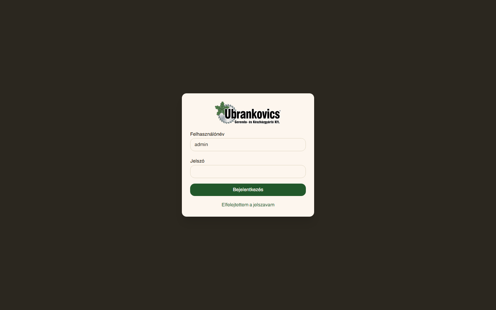

Lépj be a felhasználóneveddel és jelszavaddal. Ha a fiókodon be van kapcsolva a kétlépcsős azonosítás, a rendszer a belépés után a hitelesítő alkalmazás kódját is kéri.

Az oldal tetején egy **felső keret** található, ez minden oldalon ugyanott van. A keret négy fő területből áll, alatta pedig az aktív terület oldalainak almenüje látszik:

| Terület | Almenü |
|---|---|
| **Értékesítés** | Érdeklődők, Ügyfelek, Kampányok, Előrejelzés |
| **Projektek** | Projektek, Feladatok, Naptár, Jegyek |
| **Pénzügy** | Pénzügy, Riportok |
| **Rendszer beállítások** | Törzsadatok, Alvállalkozók, Felhasználók*, Auditnapló* |

* Csak adminisztrátornak látható.

A keret jobb oldalán találod a **Keresés** gombot (Ctrl+K, az egész rendszerben keres), az **Értesítések** harangot (a rád váró teendők és figyelmeztetések száma a harangon látszik; kattintásra lenyílik a lista, itt kapcsolható be a napi összefoglaló e-mail is), a saját nevedet (fiókbeállítások) és a kijelentkezés gombot. A bal felső logóra kattintva a **Kezdőlapra** jutsz. Telefonon a keret összecsukódik: a bal felső gombbal nyílik a teljes menü.

**A munka a projekten belül történik.** Egy projekt oldalán minden megtalálható, amire szükséged van: tételek, ütemezés, feladatok, naptár, ajánlat, napló, átadás, dokumentumok és a beállítások (3.4). A Feladatok, Naptár és Jegyek menüpontok csak összesítő nézetek az összes projektről.

## 2. Kezdőlap

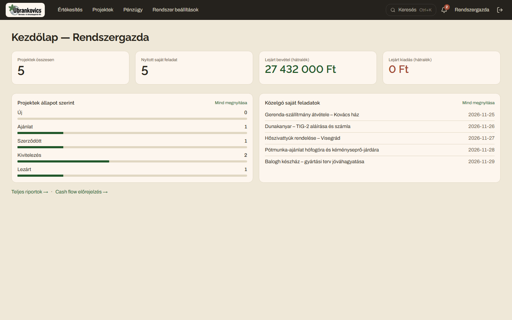

A kezdőlap egy pillantás alatt megmutatja a cég helyzetét: az aktív projektek számát és állapotát, a nyitott és lejárt követeléseket, a közelgő határidőket. A színes sávok a projektek állapot szerinti megoszlását mutatják. A lejárt követelés (pirossal jelölt összeg) azonnali teendőt jelent: érdemes ráklikkelni, és a projekt pénzügyi fülén megnézni, melyik számla késik.

## 3. Projektek

A **Projektek** oldal három nézetben mutatja ugyanazokat a projekteket. A nézetváltót az oldal tetején találod, a választásodat a rendszer megjegyzi. A keresőmező név, ügyfél vagy építési cím alapján szűri a találatokat mindhárom nézetben.

### 3.1 Lista

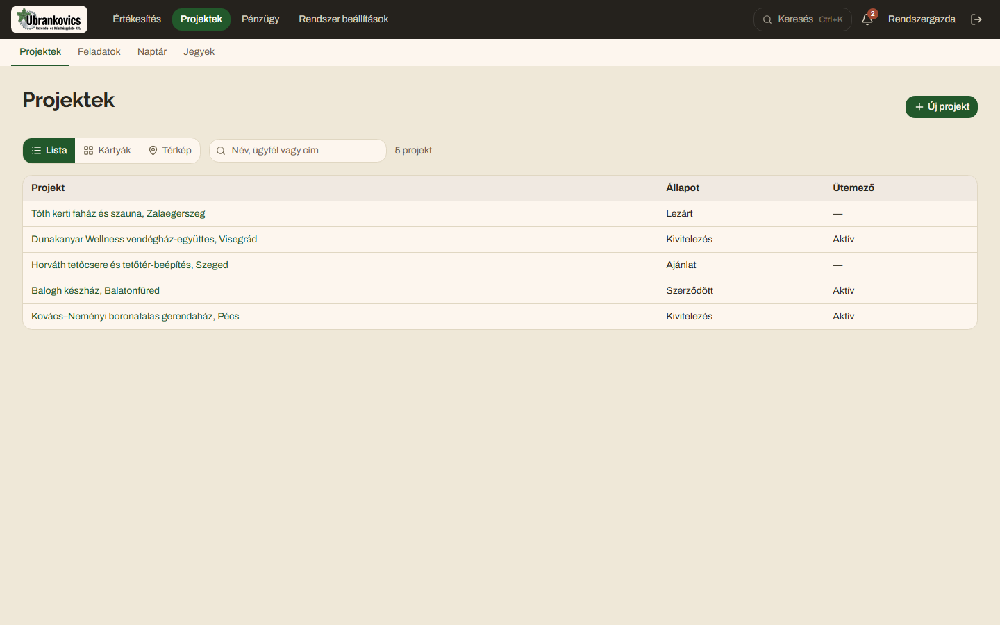

Táblázatos nézet: név, ügyfél, állapot, készültség, átadási határidő. Ez a leggyorsabb módja az összehasonlításnak.

### 3.2 Kártyák

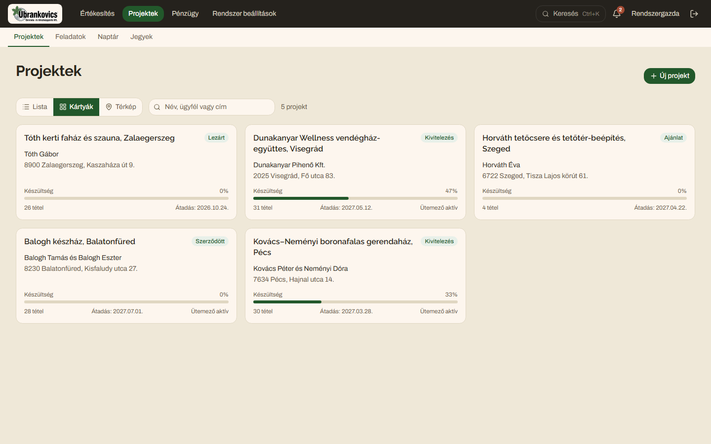

Minden projekt egy kártya: az állapot, az ügyfél, az építési cím, a készültségi sáv, a tételek száma és az átadás dátuma látszik rajta. A kártyára kattintva megnyílik a projekt.

### 3.3 Térkép

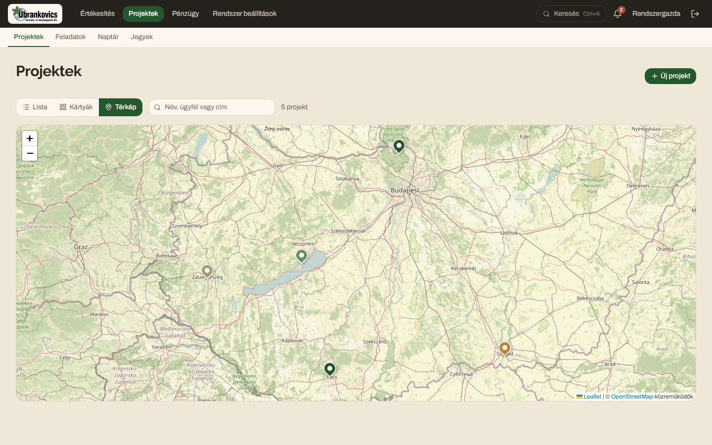

A térképen minden projekt az építési címénél jelenik meg, az állapotát jelző színű jelzővel. A jelzőre kattintva a projekt rövid adatai, majd a projekt oldala érhető el.

Ha egy projekthez még nincs térképi pozíció, az oldal alján megjelenik a **Címek feloldása** gomb. Erre kattintva a rendszer az építési címekből koordinátákat készít. **Figyelem:** ilyenkor a címeket az OpenStreetMap (Nominatim) szolgáltatásnak küldjük el, ezért ez csak a te kifejezett kérésedre történik.

### 3.4 Egy projekt részletei

A projekt oldalán fülek találhatók: **Áttekintés, Tételek, Ütemezés, Fázisok, Feladatok, Naptár, Ajánlat, Építési napló, Átadás, Dokumentumok, Beállítások**. A leggyakrabban használtak:

**Áttekintés** – az ügyfél és az építési cím, a projekt szerepkörei (építésvezető, projektfelelős), alapadatok.

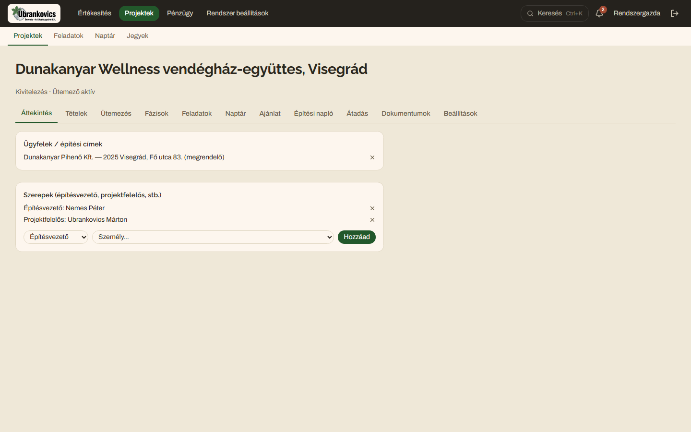

**Tételek** – a projekt költség- és mennyiségi tételei.

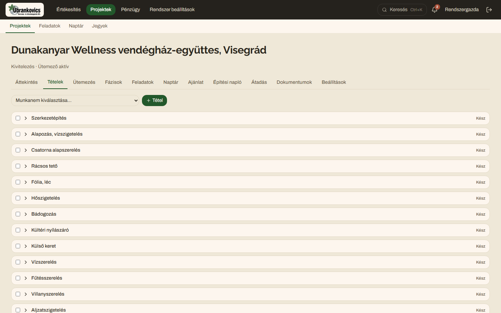

**Ütemezés / Fázisok** – a munkafázisok időrendje. Az **Ütemezés** fül akkor működik, ha az ütemező be van kapcsolva a projektnél (kikapcsolt állapotban az Ütemezés fülön egy gombbal, vagy a Beállítások fülön kapcsolható be). Bekapcsolva a tételekhez kezdő- és befejező dátum, felelős és függőség rendelhető, a rendszer kiszámolja a határidőket, a sorrend húzással módosítható, és a Gantt-diagram PDF-ben is letölthető.

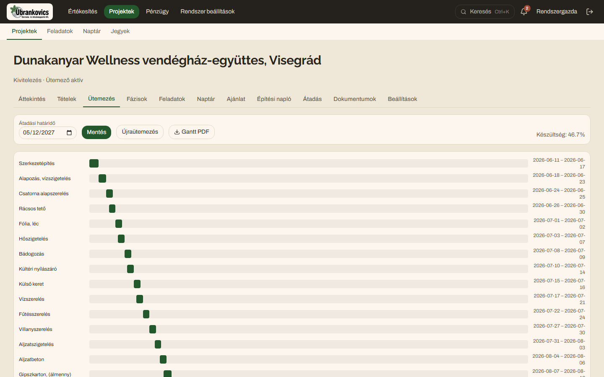

**Ajánlat** – vevői ajánlatok verziókkal. Az új verzió összehasonlítja magát az előzővel, és megmutatja, mi változott és mennyivel. Az ajánlat állapotai: tervezet → elküldve → elfogadva / elutasítva. Elfogadás után a szerződés létrehozható.

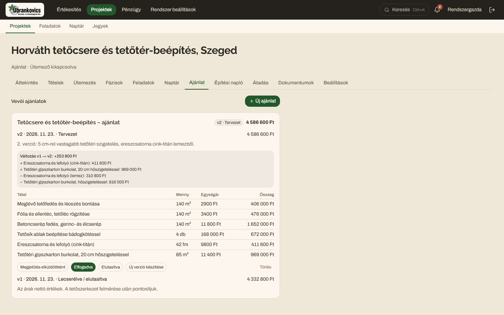

**Építési napló** – napi bejegyzések, időjárással, létszámmal, fotókkal.

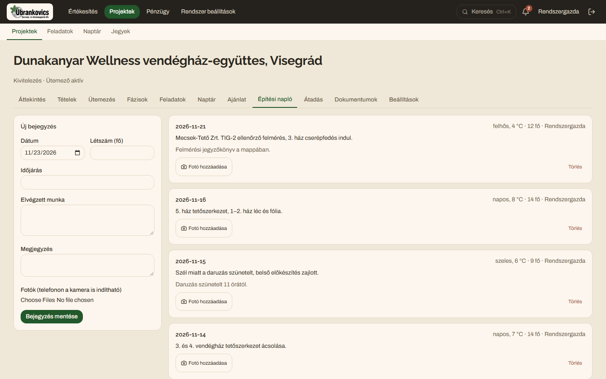

**Átadás** – az átadás-átvételi jegyzőkönyv, hibalista és jótállási határidők.

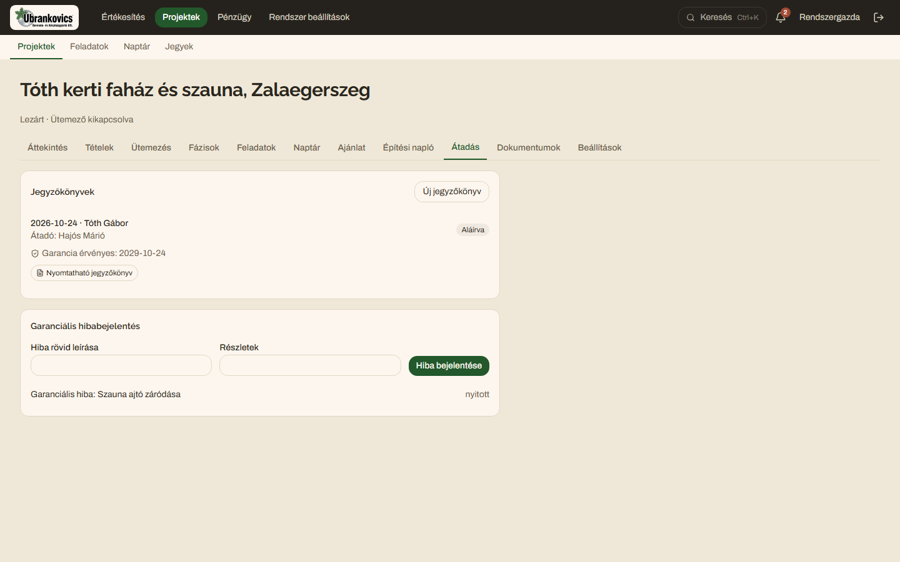

**Feladatok** – a projekt saját teendői: új feladat címmel, leírással, határidővel és felelőssel; a pipával késznek jelölhető, a lejárt határidő pirossal látszik.

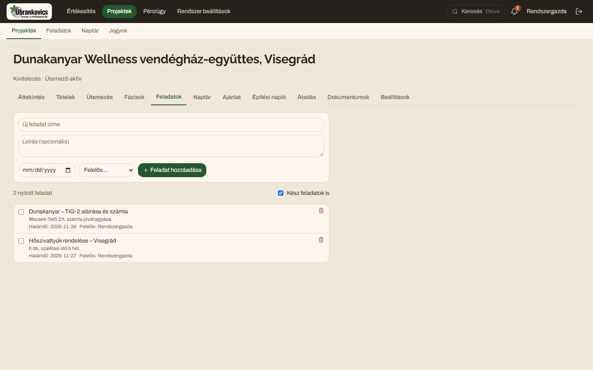

**Naptár** – csak ennek a projektnek a határidői (feladatok, ütemezett tételek, átadás, garancia lejárata), havi nézetben.

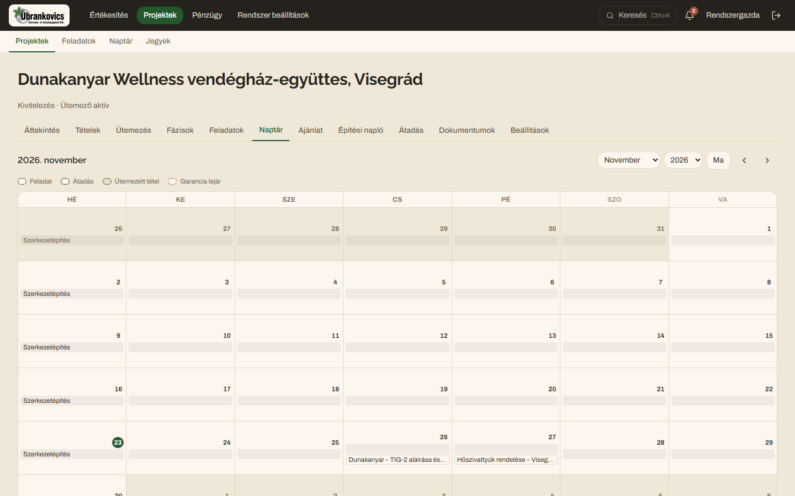

**Beállítások** – az ütemező be- és kikapcsolása, a projekt alapadatai (név, állapot, átadási határidő, helyrajzi szám, e-napló iktatószám, mappa útvonal, térképi koordináták) és a projekt törlése.

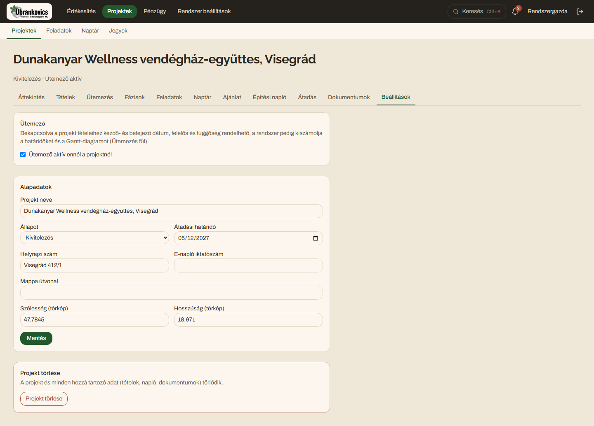

**Dokumentumok** – a projekthez feltöltött fájlok. Itt található a **DOCX generálása** gomb is: a feltöltött sablonból a projekt adataival kitöltött Word-dokumentumot készít (lásd 7.2).

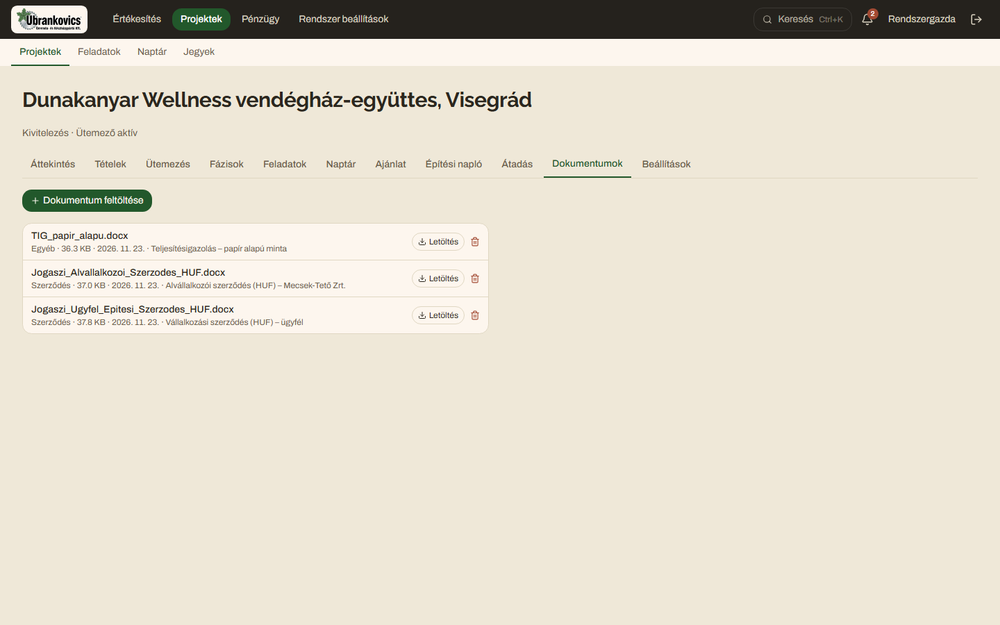

## 4. Pénzügy

A Pénzügy oldalnak négy lapja van.

### 4.1 Cash flow előrejelzés

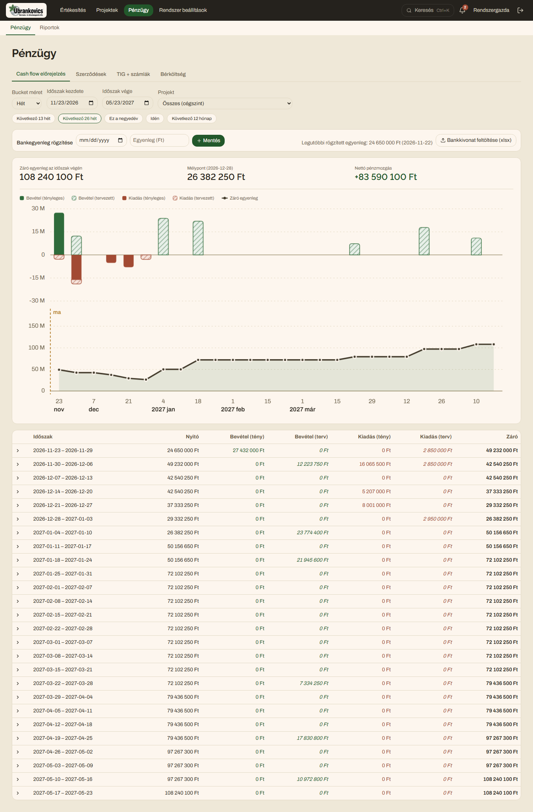

A gördülő cash flow az elkövetkező hetek tervezett bevételeit és kiadásait mutatja, az induló bankegyenleggel együtt.

- **Időszak:** az előre beállított gombokkal (pl. *Következő 26 hét*) vagy saját **tól–ig** dátummal választhatod meg, mekkora szakaszt nézel.
- **Oszlopok:** a zöld a bevétel, a barna a kiadás. A **csíkozott** oszlop tervezett (még nem teljesült), a tömör oszlop tényleges tétel.
- **Terület és vonal:** a záró egyenleg alakulása. Ha az egyenleg nulla alá süllyed, a rendszer ezt kiemeli, így időben látod a finanszírozási igényt.
- **Függőleges jelölő:** a mai nap. Az oszlopok fölé víve a hét részletei jelennek meg.

### 4.2 Szerződések

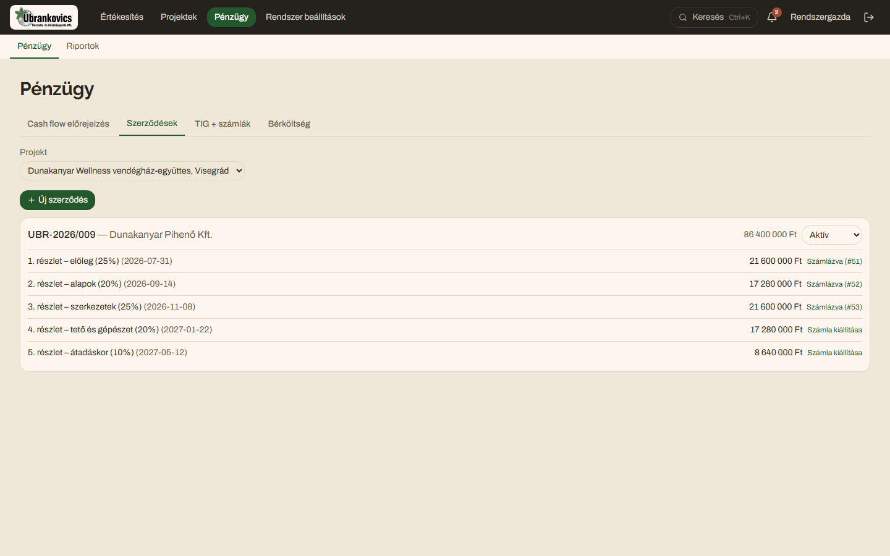

Válaszd ki a projektet, és megjelenik a hozzá tartozó szerződés részletfizetési ütemezéssel. Minden részletnél látszik az összeg, az esedékesség és az, hogy kiállították-e már a számlát (**Számlázva**) vagy még teendő (**Számla kiállítása**). Új szerződést az **Új szerződés** gombbal rögzíthetsz.

### 4.3 TIG és számlák

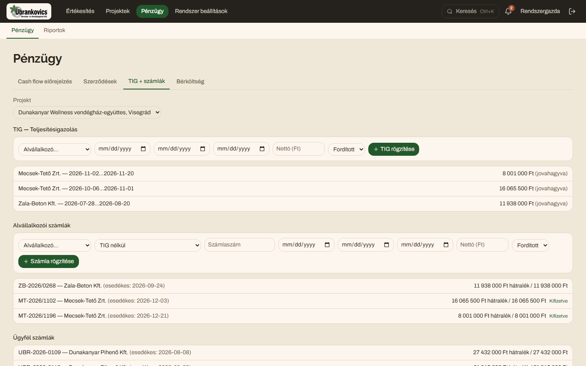

Három blokk, projektenként:

1. **TIG – teljesítésigazolás:** az alvállalkozó elvégzett munkájának igazolása időszakkal és nettó összeggel.
2. **Alvállalkozói számlák:** a beérkező számlák, a TIG-hez kötve vagy anélkül; látszik a hátralék és az esedékesség.
3. **Ügyfél számlák:** a kimenő számlák. A **Kifizetve** jelölés mutatja, mi érkezett meg; ami lejárt és nincs kifizetve, az a kezdőlapon is megjelenik.

### 4.4 Bérköltség

A tervezett bérköltségek itt rögzíthetők; a cash flow előrejelzés ezeket is figyelembe veszi. A bankkivonat (xlsx) importja a bank-egyenlegeknél érhető el: a rendszer a tételeket automatikusan a projektekhez rendeli, a bizonytalan találatokat pedig jóváhagyásra felkínálja.

## 5. Értékesítés: érdeklődők és ügyfelek

### 5.1 Érdeklődők

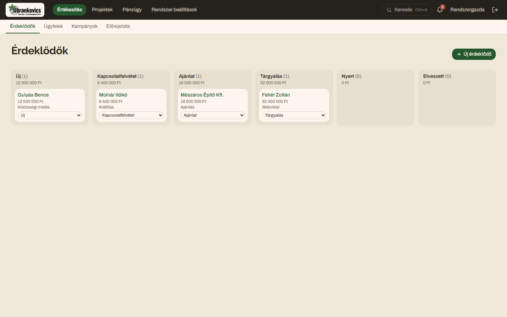

Az érdeklődők kanban-táblán követhetők: *Új → Kapcsolatfelvétel → Ajánlat → Tárgyalás → Nyert / Elveszett*. Az oszlopfejlécben látszik az oszlop összértéke. A kártyán lévő legördülővel lehet továbbléptetni az érdeklődőt. Egy nyert érdeklődőből ügyfél és projekt lesz.

### 5.2 Ügyfelek és interakciók

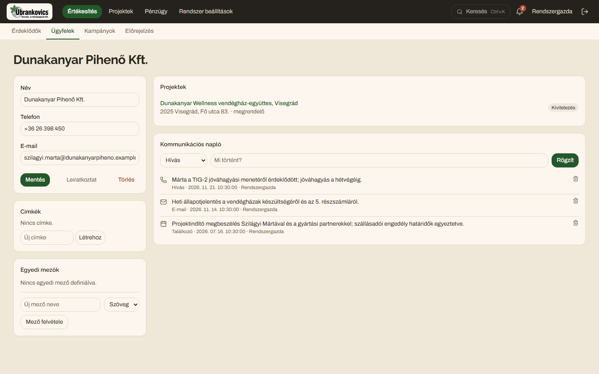

Az ügyfél oldalán időrendben látod a kapcsolattartás történetét (hívás, e-mail, találkozó, helyszíni bejárás), az ügyfél projektjeit, ajánlatait és szerződéseit. Új interakciót a megfelelő űrlappal rögzíthetsz; a következő lépéshez határidő is megadható, ami feladatként is megjelenik.

## 6. Feladatok, naptár, jegyek

**Feladatok** – a teendők listája felelőssel és határidővel; a lejárt feladatok kiemelve jelennek meg.

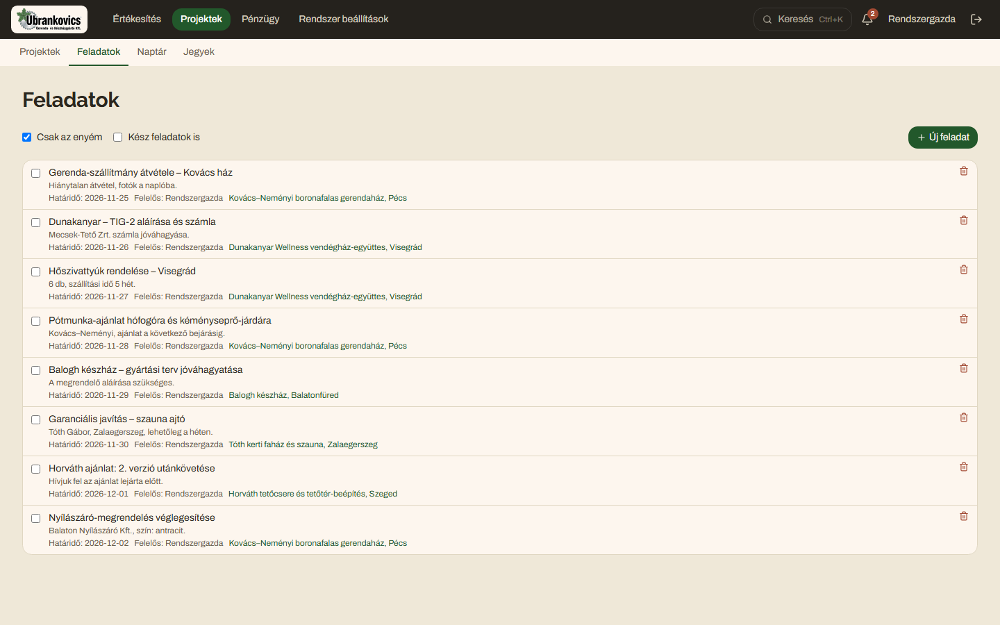

**Naptár** – az összes projekt határidői, átadásai és ütemezett eseményei havi nézetben. A hónap és az év legördülőből választható, a **Ma** gomb visszaugrik a mai napra; a jelmagyarázat mutatja az esemény típusait (feladat, átadás, ütemezett tétel, garancia lejár). Egy napra kattintva csak annak a napnak az eseményei jelennek meg a lenti listában, a címre kattintva pedig megnyílik a projekt. Az **iCal exportálás** gombbal a határidők a saját naptáralkalmazásodba (Outlook, Google Naptár) is átvihetők.

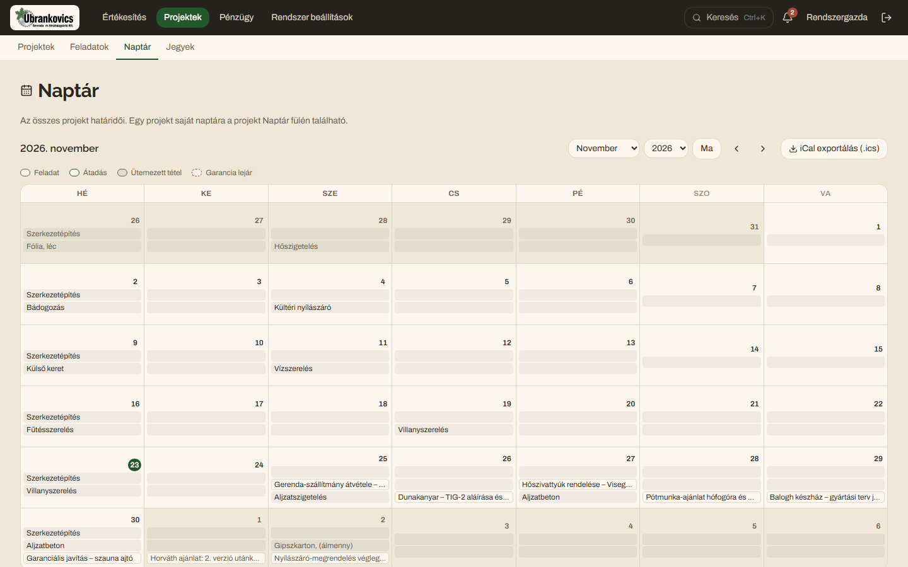

**Jegyek** – hibabejelentések és belső kérések nyomon követése állapottal és felelőssel.

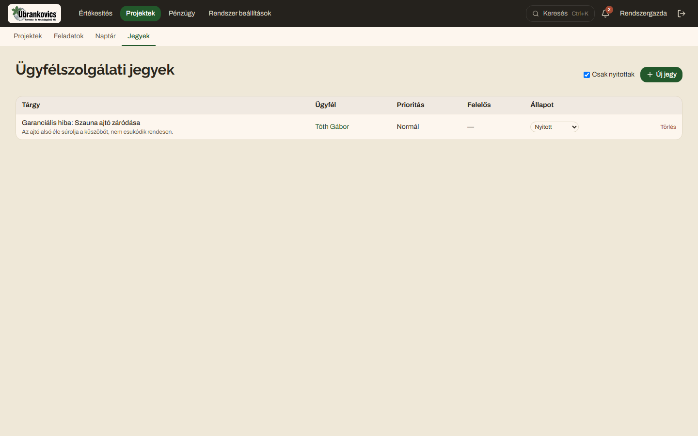

## 7. Törzsadatok: alvállalkozók és dokumentumsablonok

### 7.1 Alvállalkozók

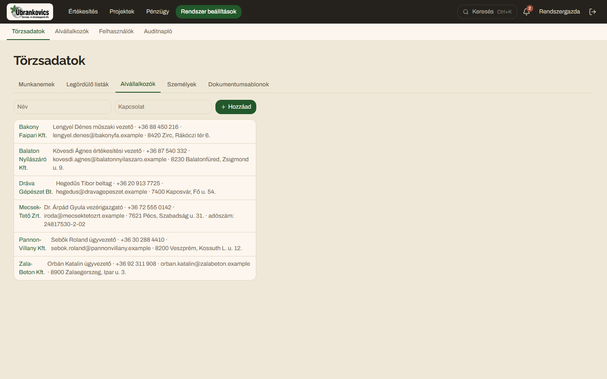

Az alvállalkozók (például a tetőfedő Mecsek-Tető Zrt., vagy a betonozást végző Zala-Beton Kft.) adatai, elérhetőségei és szakterületei. A TIG-ek és a beérkező számlák ide kapcsolódnak.

### 7.2 Dokumentumsablonok

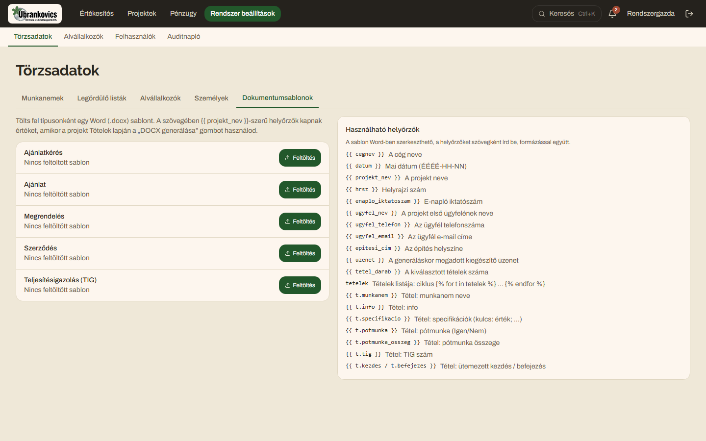

A **Törzsadatok → Dokumentumsablonok** lapon Word (`.docx`) sablonokat tölthetsz fel. A sablonban `{{ mezőnév }}` formájú helyőrzők állnak (például az ügyfél neve, a projekt címe, az összeg). A projekt **Dokumentumok** fülén a **DOCX generálása** gombbal a rendszer a kiválasztott sablont a projekt adataival kitöltve letölthetővé teszi. Az eredeti sablon nem változik, bármikor lecserélhető.

## 8. Riportok és előrejelzés

**Riportok** – összesítések projektekről, bevételről, költségekről és értékesítésről.

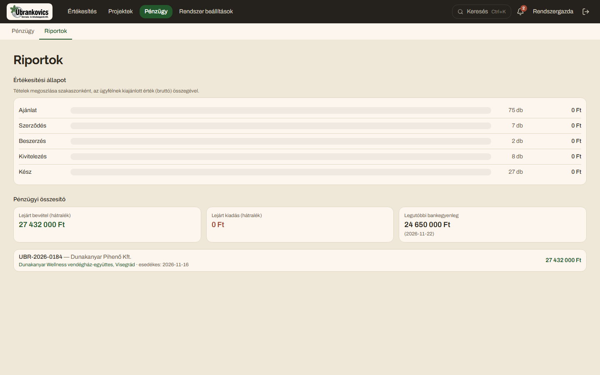

**Előrejelzés** – az értékesítési csővezeték várható bevétele súlyozva a valószínűségekkel, heti és havi bontásban.

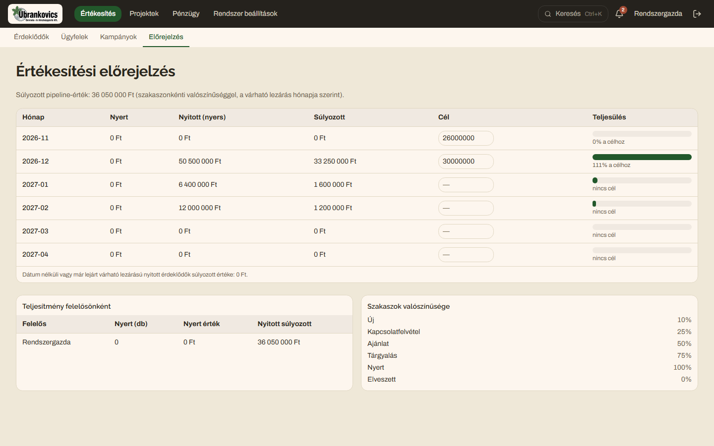

## 9. Keresés és mobil használat

### 9.1 Globális keresés

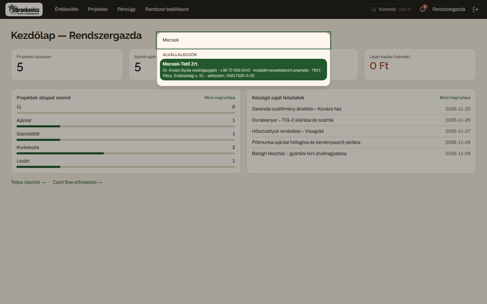

A **Ctrl+K** billentyűkombinációval (vagy a felső keret Keresés gombjával) bárhol rákereshetsz projektre, ügyfélre, alvállalkozóra, dokumentumra; a találatra Entert nyomva azonnal odaugrik a rendszer.

### 9.2 Mobil nézet

A rendszer telefonon is használható; a menü a bal felső gombbal nyitható, a keresés és az értesítések a keretben maradnak, a fülek vízszintesen görgethetők.

| Projekt oldal | Projektkártyák |
|---|---|
| 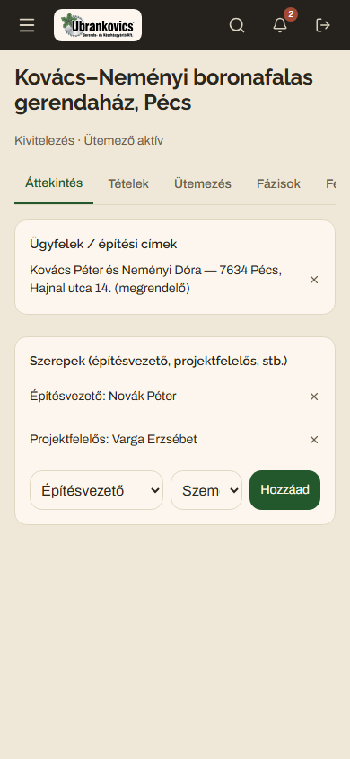 | 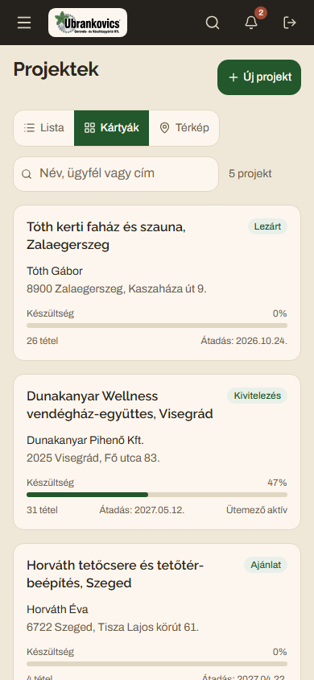 |

## 10. Gyakori kérdések

**Nem látok egy menüpontot.** A látható funkciókat a szerepköröd határozza meg; a hozzáférést a Felhasználók oldalon az adminisztrátor állítja.

**Egy projekt nem jelenik meg a térképen.** Nincs építési címe, vagy még nem lett feloldva. Add meg a címet a projekten, majd a Térkép nézet alján kattints a **Címek feloldása** gombra.

**Hogyan lesz egy érdeklődőből projekt?** Lépteteld az érdeklődőt *Nyert* állapotba, majd az ügyfél oldalán rögzítsd a szerződést; a szerződés létrehozása elindítja a projektet.

**Hol látom, ki mit módosított?** Az **Auditnapló** menüpontban, időrendben.

**Demo-adatok betöltése / takarítás (adminisztrátoroknak).** A backend konténerben:

```bash
python scripts/takaritas.py            # megmutatja, mit törölne
python scripts/takaritas.py --apply    # törli az üzleti adatokat (felhasználók és törzsadatok maradnak)
python scripts/demo_adatok.py          # kitalált demo-adatok betöltése
```

Éles használat előtt a takarítás előtt mindig készíts adatbázis-mentést.
